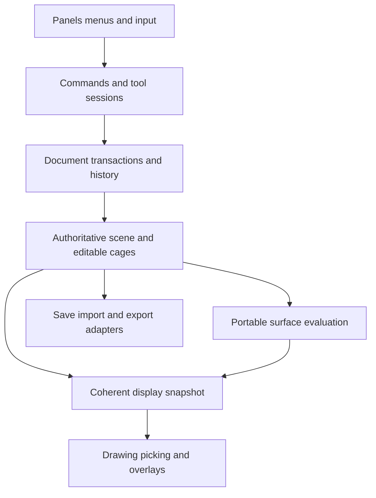

# Operandi Architecture

Draft for review • Version 0.1 • 24 October 2026

Operandi should have one authoritative editable model, a separate service that calculates its smooth surface, and a consistent snapshot used to draw and select that surface. Edits must carry geometry, attributes, selection correspondence, and history together. This document proposes those boundaries and explains how the existing Rust project can move toward them in small, verifiable steps.

The recommendation is selective reuse. Preserve the portable core, tested geometry, numeric controls, persistence safeguards, and useful viewport work. Adapt their ownership and interfaces where the audit exposes a concrete limitation. The architecture milestone ends with reviewed decisions and isolated validation evidence before production migration begins.

### The design in ordinary language

- Every face has a dependable identity. Its array position can change without a named set suddenly pointing to another face.
- Every edit says where new pieces came from. Selection, sets, UVs, labels, and creases can follow different inheritance rules.
- Extrude separates making the new pieces from moving them. Returning movement to zero keeps the begun topology; Redo restores the recorded movement.
- A subdivision service calculates the smooth model. The viewport and mouse use matching results and the same parent transforms.
- History keeps recoverable states while sharing unchanged data where measurements justify it. No speed improvement is claimed before measurement.

### What this document decides and does not decide

The user approved the behavioral direction and authorized writing this architecture. The engineering choices below are recommendations for review, not accepted implementation decisions. Proposed contracts use “must” to define a candidate design precisely; that wording does not grant implementation approval. No production code, prototype, dependency, file-format migration, or installation is authorized by the existence of this draft.

Read pages 1–4 for the overall model, pages 5–16 for system contracts, pages 17–20 for decisions and validation, and pages 21–24 for migration, open questions, and sources.

## 02 Scope and evidence

### Product requirements carried forward

The first usable release must create, edit, organize, save, and export subdivision models with a small reliable toolset. A functional UV editor, action centers, falloffs, and customizable workspaces are required. macOS, Windows, and Linux are first-release targets, even though only macOS has current development evidence. Rust is the core language; justified native libraries remain possible. [R1]

Linked instances, independent copies, versioned extension interfaces, and accommodation for multiple documents belong in the design. Multiple-document UI, full scripting, animation, rigging, and final rendering remain later work. A procedural modifier stack is not a prerequisite. Outperforming Modo is a product ambition requiring equivalent-work measurements, not a current capability. The project license, exporter list, minimum hardware, and numerical release performance targets remain open.

### Evidence has separate meanings

| Label | Meaning in this document |
| --- | --- |
| Requirement | Explicit product direction or a recorded user decision |
| Current code | Inspected behavior at commit 162b9204db37ba645b96c72ee9c1b610977ced83 |
| Observed example | User-reported Modo result or an investigator-reviewed behavior candidate; bounded by its fixture and capture method |
| Proposal | Recommended Operandi design requiring review and validation |
| Open | A missing behavior, policy, measurement, or adoption decision |

The source audit is static. Historical tests and builds in earlier reports were not rerun for this document. Behavior candidates B and C have investigator review, but are not automatically admitted implementation packages. Architecture drafting does not change that status. A later implementation assignment needs a reviewed, bounded handoff and its own acceptance criteria. [R2, R3, B-A, B-B, B-C]

### Evidence limits to preserve

Modo live Redo lost a drag; Operandi should restore it. Whole-operation Cancel, held-drag update timing, and hierarchy lasso remain unverified. Converted evaluated polygon tags are an unreliable capture correspondence, not evidence of application tag loss. No reference performance data was collected. A native reopen transform difference near 3 × 10⁻⁹ is distinct from exact in-memory restoration.

## 03 Existing implementation

The two-crate boundary is useful: operandi-core contains portable modeling state and operations; operandi-app contains egui/eframe UI, input, platform adapters, and wgpu drawing. The lockfile records eframe/egui 0.33.3 and wgpu 27.0.1. These are current dependencies, not an architecture endorsement for every future requirement. [C1]

| Concern | Current implementation | Consequence |
| --- | --- | --- |
| Mesh | Indexed polygon loops; derived canonical edges | Useful foundation; mesh identities are storage positions or endpoint pairs |
| Attributes | Sparse corners, point maps, UV assignment records, sets, labels, creases | Rich data; inheritance remains operation specific |
| Interactive edit | Editor owns Live base scene and replacement previews | Atomic candidates exist; zero live Extrude restores the original cage |
| History | Before/after Scene snapshots, up to 100 checkpoints | Comprehensive stored-state restoration; large copies and restricted live history |
| Scene | Items own meshes and parent references | Hierarchy exists; shared resources and linked-instance commands are absent |
| Evaluation | Stored subdivision representations and creases | No evaluated subdivision engine found |
| Viewport | Frame-local cage triangulation and picking structure | Useful GPU path; picking omits parent transforms used by drawing |
| Persistence | Validated JSON versions 1–8 and atomic .opscene saving | Preserve safety behavior; OPS schema and migration remain open |

The current Extrude boundary-owner selection already resembles the observed wall-label rule. It still refuses any mesh containing named sets or typed data. Its sparse-cap promotion visits selected faces in selection order; the new conflict fixture instead requires independence from selection order and sensitivity to stored face order. These are integration tasks to validate, not evidence that the entire kernel should be discarded. [C2–C5]

Earlier audit results record 305 ordinary test passes, three ignored tests, and eight failures when full SST attribute acceptance is explicitly run. Current Bevel sweep source expects 173 geometric matches plus 10 qualified refusals. Older status notes lag that contract. None of these historical/source observations is a new test run. [R2, C9]

## 04 Ownership and data flow

### Proposed system model

Only the document transaction boundary publishes model mutations. Commands ask for changes; geometry operations build candidates; evaluation derives results; presentation consumes snapshots. A consumer does not acquire private Editor fields or mutable Mesh references merely because it can inspect the scene.

| Owner | Owns | Does not own |
| --- | --- | --- |
| Application host | Documents, focused document, resources, preferences | Geometry algorithms |
| Document controller | Current model, edit state, history, revision allocation | Windows and GPU buffers |
| Tool session | Targets, accepted parameters, stage bases, continuation | Independent copies of the whole undo stack |
| Evaluation service | Derived topology, samples, correspondence, caches | Authored mesh edits |
| Presentation adapter | Camera, display settings, picking policy, coherent snapshot | A second editable scene |
| Renderer | Device, buffers, textures, submissions | Model identity or undo policy |
| File adapters | Explicit external schemas and conversions | UI state or live mesh ownership |

Keep these as cohesive Rust modules within a small number of crates initially. Split a crate only when dependency isolation, independent testing, or an actual consumer justifies it. Domain code must work without a window or graphics device. New subsystems receive explicit read interfaces or transaction services; no global service locator or universal scene framework is required.

## 05 Mesh topology and identity

### Recommended editable representation

Retain ordered polygon loops, with explicit vertex, edge, face, and corner identities backed by compact storage. Add an incidence view mapping vertices and edges to their face uses. Make incidence derived and revision scoped first; compare incremental maintenance only in the topology prototype. Avoid assuming every edge has exactly two uses.

This approach preserves the existing polygon/corner model and its n-gons, disconnected pieces, and sparse attributes. Compare it against a conventional half-edge representation and a radial incidence representation in P01. Freeze the physical layout only after mutation correctness and memory costs are measured. Identity and attribute contracts should survive a later storage change.

### Identity is different from position and order

Use typed identifiers scoped by DocumentId and MeshId, with nonreused element IDs for VertexId, EdgeId, FaceId, and CornerId. Dense offsets and evaluation indices are temporary lookup results. An explicit face-order sequence preserves meaningful logical order independently of IDs and physical compaction. Operations declare output order as well as source correspondence. A surviving cap identity need not retain its old ordinal. Save and Undo preserve the declared order.

The document identity allocator is monotonic across Undo and abandoned previews. Undo restores prior element identities; a later branch never reuses an abandoned identity for another element. Restoring an allocator counter from an old snapshot must not create collisions. Invalid references return a diagnostic, not a newly occupied slot.

Proposed Shift policy: preserve the logical cap face and its corresponding corners while assigning new IDs to duplicated vertices, walls, and new edges. This is an Operandi design choice, not a claim about Modo allocation. Other topology operations explicitly declare survival, replacement, split, merge, and deletion mappings.

### Topology support is explicit

Store finite, structurally valid polygon data, unused points, and documented coincident or zero-area stages without welding by position. Validate operation-specific admissibility separately. Preserve already supported exceptional incidence data during migration; do not silently reinterpret it as ordinary manifold geometry. Initial evaluation may refuse an unsupported topology class with a precise reason while preserving the cage. The zero-distance cube stage is required supported input, not an invalid face to delete. [B-A, B-C]

## 06 Attributes and correspondence

### One edit carries several maps

Every topology edit returns geometry plus an EditCorrespondence record: surviving and replaced elements, new-element roles, source corners, boundary owners, selected output elements, and deleted references. Attribute transport consumes this explicit record. A single “copy everything from the selected face” rule is insufficient.

Keep current selection ordered and scoped to an item/instance. Store named sets as mesh-element membership, independently of current selection. Recalling a set resolves stable IDs in the current mesh; deleted members are removed or reported according to the operation contract. Set mutation is part of the same transaction as geometry.

### Sparse data remains authored data

Each map has an identity, type, domain, interpolation policy, and optional default. Authored corner assignment, point assignment, and resolved effective value remain separate. An assigned zero is present. Preserve known UV assignment identities; unknown legacy sharing stays unknown rather than being inferred from equal values. Rendering can use a temporary packed value plus validity mask; it must not materialize those values back into authored storage.

| Tested Shift output | Required correspondence in the bounded examples |
| --- | --- |
| Cap selection | Only output caps selected |
| Cap sets and labels | Follow the selected source face |
| Wall sets and labels | Unselected face across the original edge; selected source at an open edge |
| Wall UV old side | Boundary-owner corner values and presence |
| Wall UV new tips with None | Absent in the tested corner-only maps |
| Missing cap UV | Can acquire a selected neighbor's assignment; unselected neighbors do not supply it |
| Existing cap UV including zero | Preserve the existing assignment and seam |

Preserve the exact conflicting-donor fixture: changing selection order leaves the result unchanged; swapping stored neighbor-face order changes the donor. Implement a bounded compatibility rule only after handoff admission. Do not generalize this into a universal first-face traversal law. Keep UV ownership separate from wall ownership. Typed maps, normals, colors, morphs, and creases each require an explicit policy or atomic refusal; there is no universal average. [B-B, B-C]

## 07 Extrusion as a staged edit

### Separate topology creation from movement

An ExtrudeSession owns accepted configuration, target IDs, context, the pre-begin model, the begun topology, correspondence, and the latest candidate. Beginning Shift extrusion creates a real zero-distance stage. Movement changes that stage without adding another ring. Returning to zero restores the begun stage, not the pre-begin cage.

| State or event | Proposed contract |
| --- | --- |
| Armed | Configuration exists; no interactive topology has begun |
| Begin | Publish zero-distance topology and its correspondence atomically |
| Drag or accepted field change | Replace current candidate from the stage basis |
| Release | Finish the gesture and its history checkpoint; keep tool live |
| Drop | Keep accepted geometry and close the interactive session |
| Numeric Apply while armed | Evaluate one discrete operation and remain configured |
| Apply while interactive | Reject without changing geometry, matching the measured route |
| Continue or clone | Accept the prior stage and construct the next stage using its own specified gesture policy |

Retain identifiers and correspondence across ordinary displacement updates. Structural option changes such as divisions or mode rebuild from the recorded stage basis and reconcile identities by declared logical roles. New or removed roles must not acquire misleading reused identities. Cache intermediate plans only where invalidation is explicit.

### The first acceptance sequence

For the observed cube profile: S0 is 8 vertices/6 faces, S1 is begun 12/10, S2 is moved 12/10. Zero return equals S1 in checked cage/attribute/evaluation data. Live Undo traverses S2 → S1 → S0. Desired Redo traverses S0 → S1 → S2, preserving movement even though Modo lost it. [B-A]

Primary press versus release timing is unresolved; define a semantic Begin event without claiming which physical phase matches Modo. Middle-click clone retained displacement in the measured configuration. Stationary Shift reset did not reproduce; preserve the distinction and reconcile the older approved continuation requirement before changing its binding. Stage cancellation restores the stage base; whole-session Cancel behavior remains an open product decision.

## 08 Transactions and history

### Proposed mutation contract

A command resolves targets and context from revision R, builds a private candidate, validates topology/attributes/references, prepares selection and session changes, then publishes one state transition. Failure leaves the current model, history cursor, selection, and accepted session state intact. The allocator may advance, but abandoned IDs cannot leak as valid references. Stale-base commands fail or are explicitly re-resolved; they never mutate a newer mesh accidentally.

Use immutable document roots with shared unchanged geometry/attribute blocks as the recommended history candidate. History entries retain before/after roots, selection state, a resumable tool-stage descriptor where required, labels, and an explicit change classification. Do not clone the entire Editor and its history merely to stage a save or tool switch. Arc can provide shared ownership; Arc alone does not prevent a whole large mesh from being copied on mutation. [T3]

Full-scene snapshots remain the correctness control. Compare resource-level sharing first, then chunk sharing or narrow deltas only if P02/P07 show a worthwhile gain. A command log is useful for discovery and macros but is not sufficient to restore edited geometry reliably.

### One timeline with explicit entry types

Use one ordered editor timeline for geometry, selection, and any admitted tool transitions. Geometry entries and session-only entries are distinguishable, so an unchanged picture is not automatically a failed Undo. Each tool category supplies grouping policy. Do not impose one gesture state machine on primitive drawing, inactive numeric Apply, and interactive extrusion.

Preserve begin and displacement states while live. On completion, a tested route policy decides grouping. Numeric Apply's one-step restoration is established; Escape/handle, Q, selection, and focus routes showed different sequences. The unexplained unchanged first Undo is not permission to manufacture a meaningless checkpoint. Route-level administrative grouping needs the Q02 control before a full parity claim.

Unconfirmed field text is a presentation draft: first Escape restores accepted text; viewport Escape drops the tool and retains geometry. Cancellation of a failed candidate is internal recovery, separate from a proposed user-facing whole-operation Cancel. No whole-session command is exposed as Modo-compatible until its semantics are decided.

## 09 Scene resources and documents

### Proposed ownership model

An ApplicationHost owns a document registry. Each document owns its scene graph, mesh resources, named sets, document preferences, editor history, and revisions. A SceneItem has an ID, local transform, parent, visibility, and a typed payload such as MeshInstance or Group. A MeshInstance references a MeshResourceId instead of embedding an independent Mesh value in every item.

Independent duplicate creates a new mesh resource and remaps resource-local element references. Linked duplicate creates another item referencing the same mesh resource. Make Unique creates a distinct resource and retargets one item atomically. Proposed initial semantics: geometry, UVs, and mesh sets are shared by linked instances; item transforms remain independent. Per-instance geometry/attribute overrides require a separate decision. This recommendation does not declare their UI or complete behavior already approved.

Current selection uses instance context plus element identity. Selecting a face on one instance does not implicitly select every instance, even though editing the shared mesh can affect them all. Display correspondence identifies both the instance and underlying mesh element.

### One hierarchy transform contract

Compose world transforms from the complete parent chain once per scene revision. Drawing, surface picking, component markers, lasso, framing, tool contexts, and export adapters consume that contract. Store mesh points in local coordinates. Detect cycles, dangling parents, invalid transforms, and unsupported singular cases before publishing changes. Reparenting's keep-world versus keep-local behavior remains an explicit command policy.

Transform normals using the appropriate inverse-transpose path and handle mirrored winding consistently. Test nonuniform scale, negative scale when supported, and nested parents; do not validate only translation. The observed parent cases establish visible agreement, not an internal Modo matrix layout. [B-B]

Document IDs scope commands and asynchronous results even while the UI initially shows one document. A closed document invalidates its pending jobs. Cross-document sharing and copy/paste use explicit conversion/duplication; no mutable global scene pointer or accidental cross-document history is allowed.

## 10 Subdivision evaluation

### Portable evaluation contract

The evaluator consumes an immutable MeshRevision, explicit settings, requested channels, and purpose. It returns an immutable EvaluatedSurface: indexed geometric points, oriented faces/triangles, corner-channel data and validity, normals or a declared normal method, source-face/edge/vertex correspondence, diagnostics, and a complete result key. GPU resource layouts are not part of this type.

Settings distinguish scheme, boundary behavior, crease interpretation, face-varying interpolation, display level, and export/evaluation level. “Linear UV off” and “Crease All” are observed product settings; map them to a backend only through tested examples. Do not equate another library's similarly named option or crease weight with the reference automatically.

### Backend recommendation

Prototype an OpenSubdiv CPU adapter as the leading library candidate, alongside a small independent Rust refinement control for simple fixtures. OpenSubdiv separates topology processing from attribute evaluation and exposes client mesh adapters. Those are useful interface precedents, not evidence of Modo equivalence. Current public documentation describes 3.8.0; pin the tested version and review its exact license, native build, and notices before adoption. No dependency is selected or installed here. [T1, T2, T5]

Distinguish finite refinement vertices from samples on the limit surface. Modo's converted evaluated meshes and displayed markers are different measurement targets. Passing 98 points/192 triangles does not establish the correct shape or marker position. Uniform CPU evaluation is the first correctness target; adaptive tessellation and GPU evaluation remain later alternatives behind the same contract.

### Sparse channels and zero stages

Keep geometric indexing independent of UV seams so geometric counts are not inflated by packed rendering vertices. Preserve absent values with channel validity and explicit interpolation rules. Never invent zero-valued authored UVs to satisfy a backend's input requirements. If a channel's sparse interpolation is unresolved, report that channel unavailable without claiming attribute acceptance; geometry can still be evaluated.

Coincident vertices and zero-area walls in a valid begun stage must survive input preparation. Derived degenerate drawing triangles may be omitted, but their source cage faces must not be deleted. Test finite results, crease shape, UV seams, source correspondence, and independently recorded levels. [B-A, B-B]

## 11 Evaluation revisions and jobs

### Revision and cache ownership

The document controller allocates monotonically increasing publication tokens for accepted edits, previews, Undo, and Redo. Restoring old content does not restore an old publication token. Cache keys include document identity, mesh content versions, evaluator/settings version, and purpose. Content can be reused when equal; a result can be published only for the currently requested token.

Split versions by actual dependency: topology and face order; positions; attribute values; per-channel assignment topology; creases/settings; scene transforms; visibility; and selection. A conservative invalidation is acceptable initially. An incorrect reuse is not. The evaluation service owns derived caches; the document owns authored versions.

| Change | Required dependency effect |
| --- | --- |
| New faces or changed logical face order | Rebuild incidence/correspondence and affected refinement/channel topology |
| Positions only | Recalculate positions, bounds, normals; reuse topology only if applicable |
| UV assignment presence or seam identity | Rebuild that channel's topology and values |
| UV values only | Recalculate that channel's values |
| Crease weight or boundary setting | Rebuild affected rules/weights and dependent surface data |
| Parent transform | Update instances/world bounds and world-space queries; reuse local surface |
| Selection only | Refresh highlights and policy state; retain geometric evaluation |

### Safe scheduling

Begin with synchronous CPU evaluation for small correctness fixtures. Keep immutable inputs so asynchronous execution can be added without changing ownership. Coalesce superseded drag requests; cancellation reduces wasted work, while token validation is what prevents stale publication. A late result cannot overwrite a newer drag, Undo, or reopened document.

A presentation snapshot includes its scene transform, geometry, attributes, correspondence, and picking data under one token. While a newer result is pending, retain the complete older snapshot or wait; never mix a new cage mapping with an old surface. Picking is tied to the displayed snapshot. If its result targets an outdated editable revision, revalidate or defer the edit. Save/export request a complete result for their chosen revision rather than whichever preview happened to finish last.

## 12 Viewport picking and input

### Consistent display and selection

The presentation adapter combines local evaluated geometry with scene instances, transforms, visibility, camera, and component-selection policy. The resulting DisplaySnapshot is the sole input to drawing, surface picking, component picking, overlays, and framing. Picking acceleration is derived from the same surface and transform state; it does not reconstruct its own local-only world coordinates.

Each displayed triangle maps to a source FaceId. Evaluated edge curves and displayed vertex markers map to editable EdgeId and VertexId. A marker may use a limit-surface sample even when exported mesh points use finite refinement; the snapshot records that sampling method. Highlighting follows the displayed smooth patch or curve. UV-space picking uses the corresponding map assignment identities.

Observed component visibility differs by mode: the sampled far-side vertex was selectable in Default, while the sampled occluded edge needed Wireframe. Explicitly hidden caps were excluded. Preserve these as separate acceptance examples; no single “occlusion on/off” boolean should silently govern every mode and gesture. General through-selection remains open. [B-B]

### Input routing

Platform adapters translate physical events into semantic intents. Focus ownership resolves text, popups, tool gestures, selection, navigation, and global commands in a central policy before dispatch. UI labels, menus, and shortcuts invoke the same operations. Mouse capture loss or document closure terminates a gesture predictably without inventing a geometry commit.

Numeric controls keep unconfirmed text separate from accepted quantities. Validation errors retain the last valid candidate and identify the failing field. Escape follows the recorded focus distinction. Key assignments are configuration, not a universal fact inferred from one runtime's W or Space behavior.

The renderer retains wgpu as the prototype path, consumes prepared data, and owns device resources and submission lifetimes. It may pack vertices differently from the domain surface. Logical UI coordinates and framebuffer pixels remain distinct. GPU completion and display texture lifetime must remain valid across resize, multiple windows, and document closure. These concerns do not move geometry ownership into the renderer.

## 13 UV editing and shared modeling context

### A functional UV editor needs its own surface

The proposed UV editor reads the same authored attribute model as the 3D tools. A UV view displays corner assignments and seams, identifies missing assignments, and maps picks to mesh corners or explicit UV assignment IDs. It never assumes one UV per geometric vertex. Editing UVs changes a channel transactionally without changing geometric points unless the command explicitly requests both.

Proposed minimum release workflow: choose a map; inspect assignments and seams; select UV components; move, rotate, and scale UVs with numeric entry and U/V handles; create or clear assignments using specified commands; and preserve results through geometry edits and save/reopen. This is a scope recommendation for review. Unwrap, packing, UDIM, seam-authoring breadth, and multi-map editing still need product decisions. Storage alone does not satisfy UV01. [R1]

### Context is explicit and tool capabilities are honest

A ModelingContext snapshot supplies target instance, local/world conversion, action center, action axis, workplane, falloff provider, symmetry, snapping, constraints, and units. Context resolution happens before candidate construction. A tool declares which combinations it supports and how they are composed. Unsupported combinations refuse without changing the document.

Preserve existing admitted action-center and axis behavior as separate compatibility profiles during migration. Context-only changes must not move accepted geometry inadvertently. A falloff provider returns weights in a declared space; geometry tools decide their admitted application law. Do not imply that Bevel's current linear field proves every tool supports live falloff.

Use shared numeric parsing, focus management, unit handling, and draft recovery. Keep parameter schemas, geometry, and lifecycle-specific acceptance local to each tool. UV U/V handles use the required teal/yellow convention; 3D X/Y/Z handles retain their required colors. Source identities, selection correspondence, and history services are shared between the two editors.

## 14 Commands tools and extensions

### Small explicit interfaces

Introduce a command registry with stable names, typed argument schemas, units, target/context requirements, availability queries, execution, result diagnostics, and history policy. Menu items, user-defined buttons/menus, command entry, and bindings refer to those names. Availability is advisory; execution revalidates against the current revision.

A ToolDescriptor registers parameter presentation, supported contexts, lifecycle category, and a session factory. A session responds to semantic intents such as Begin, Update, AcceptGesture, Continue, Drop, and CancelStage only where those intents apply. Category-specific state remains explicit. Use two existing lifecycles to challenge the interface: interactive Extrude and inactive numeric Spike. A large enum may remain internally during migration, but extensions must not require unrelated modules to know every parameter variant.

### Commands and macros have different history concerns

Proposed initial macros are sequential authored command chains. Stop on first failure, report the failing command, and retain completed earlier commands as individually undoable results. Atomic all-or-nothing macro groups are a separate capability requiring declared transactional commands. Do not promise rollback for file exports, dialogs, or arbitrary external effects. Automatic macro recording and a full scripting language remain unselected.

A display consumer can inspect immutable scene/evaluation views. An editing extension can request transactions and receive correspondence. Neither can mutate arbitrary document fields or reuse a stale handle without validation. Errors carry document, command, and target context; ordinary unsupported inputs are typed outcomes rather than panics.

### Future compatibility boundary

Keep the first registry in-process and Rust-facing as a provisional internal API. Rust traits are not a stable native plugin ABI. A later compiled-plugin boundary needs explicit API versions, ownership of buffers/strings, error transport, thread rules, unloading, and compatibility policy. Compare C ABI, out-of-process services, and scripting adapters when that milestone is scoped. No ABI, scripting language, sandbox, marketplace, or speculative animation system is selected now.

## 15 Workspaces and platform boundaries

### Proposed workspace model

Represent layout as a persistent tree of split nodes, tab groups, panel instances, viewport instances, and native-window roots. Panels own presentation state and a document/view binding; they do not own mesh resources. Moving or detaching a panel changes layout ownership without recreating the document or its history. Multiple views can show one document with independent cameras.

Separate layout/preferences persistence from native scene persistence unless a reviewed workspace requirement chooses otherwise. Stable panel IDs allow missing extension panels to appear as recoverable unavailable panels rather than corrupting the layout. A crash-recovered window position must remain reachable on the current monitor arrangement.

Retain egui/eframe for the validation candidate. Its pinned 0.33.3 documentation supports native multiple viewports, which warrants a detached-window experiment; it does not prove arbitrary docking, nesting, accessibility, or cross-platform workspace parity. P06 must demonstrate the actual required layout operations before toolkit adoption is finalized. Do not choose a replacement toolkit solely from a feature list. [T4]

### Portable domain and replaceable adapters

Keep macOS menu/input integration in platform modules. Domain geometry, identity, commands, history, evaluation settings, and serialization remain Rust APIs independent of Metal, window APIs, and egui. A selected native subdivision backend must be wrapped behind that portable interface with narrow FFI safety invariants.

GPU capabilities select supported paths explicitly; no CUDA or Apple-only requirement enters the domain contract. Windows and Linux require their own runnable packaging, input, graphics, file, and layout validation before the first usable release. Test representative AMD/NVIDIA/Intel or other selected hardware rather than inferring support from compilation.

Treat scaling as coordinate conversion, not just larger fonts. Validate resize, physical high-DPI displays, detached windows across differing scales, pointer hit targets, and offscreen surfaces. Existing simulated image sizes and Metal captures are useful regression assets but do not establish physical-display or other-platform acceptance.

## 16 Persistence and interchange

### Native document proposal

Persist an explicit versioned schema for document identity, scene items, mesh resources, stable element IDs, logical face order, attribute definitions and sparse records, sets, subdivision settings, hierarchy, and transforms. Derived incidence, evaluated caches, GPU buffers, unconfirmed text, and active-session machinery are excluded from the ordinary scene payload. Current selection persistence is a separate policy; the observed Modo reopen emptied it while retaining sets.

Use fixed-width identifiers and documented encodings; never serialize Rust memory layouts. JSON is an acceptable migration/control representation. Choosing a binary container, compression, or chunk storage requires measurements and a format decision. The desired .ops name does not make existing .opscene bytes a new schema.

Preserve current native versions 1–8 as readable inputs. A migration validates before publication, assigns stable IDs deterministically for a legacy mesh, records logical face order, and converts positional selections/sets through explicit maps. Save to a new version/path until compatibility is reviewed. Unknown mandatory fields/features fail with a diagnostic; never discard data merely to downgrade.

### Safe saves and recovery

Build a save snapshot without committing the live editor first. Apply the agreed live-save/drop policy in staged state, write through a create-new temporary, flush, atomically replace, and only then publish any intended session change. A failed save preserves the document and existing destination. Validate platform durability and rename behavior; retain imported-source protection. Recovery journaling uses immutable snapshots and a separately tested policy so a slow disk does not serialize every preview on the input path.

### Interchange boundaries

Keep the bounded LXO importer isolated. OBJ, LWO, and LXO remain requested import targets with format/version scope to decide. Exporter targets and cage-versus-evaluated options need explicit selection. An exporter requests one complete document/evaluation revision and declares lost or unsupported fields before writing. Evaluated polygon tags need an independently validated association test; the reference conversion limitation is not a tag-loss oracle.

Require exact in-memory restoration and exact authored sparse presence where representable. Across external files, report schema precision and numerical differences separately; the observed native rotation round trip does not justify silently rounding every comparison. [C8, B-B]

## 17 Decision register for geometry and editing

Every entry is a recommendation awaiting validation and review. P numbers identify the isolated validation plans on pages 19–20. None is a statement about Modo's internal implementation.

| ID | Alternatives | Recommendation | Validation |
| --- | --- | --- | --- |
| D01 Topology | Indexed loops and incidence; conventional half-edge; radial incidence structure | Keep loops and explicit corner identity; derive full edge-use incidence first. Freeze storage after measurement. | P01 |
| D02 Identity | Raw offsets; persistent typed IDs; generational handles plus persisted IDs | Nonreused typed IDs with transient dense maps and explicit logical face order. | P01, P05 |
| D03 Attribute transport | Universal copy; per-tool ad hoc edits; explicit correspondence plus map policies | Correspondence with separate selection, set, wall-owner, cap-UV, and crease policies. | P01, P03 |
| D04 History | Full scenes; inverse commands/deltas; shared immutable roots | Shared roots as candidate, full scenes as correctness control. Add chunks/deltas only after evidence. | P02, P07 |
| D05 Tool lifecycle | One generic gesture machine; independent tools; shared services with category sessions | Shared transactions/input services and explicit category sessions. Preserve route-specific grouping. | P02, P06 |
| D06 Evaluation | Original Rust engine; OpenSubdiv adapter; GPU-only engine | Compare CPU OpenSubdiv adapter with a small Rust control; keep backend-independent output and sparse semantics. | P03, P08 |

### Reasons and rejection conditions

D01–D03 address demonstrated face renumbering, sparse corner data, zero stages, and donor-order sensitivity. Reject a candidate that preserves counts but loses topology, membership, absence, seam identity, or declared order. Conventional half-edge connectivity remains a legitimate alternative if its supported topology and conversion costs fit the real operations.

D04 avoids assuming inverse commands can reproduce exact prior attributes and IDs. Reject sharing that merely moves full copies into every drag step or exposes mutable data to readers. D05 must reduce integration burden for two different lifecycles without hiding their distinctions. D06 fails adoption if it cannot match required shape/UV/crease examples, preserve supported zero stages, build on target systems, or meet an acceptable licensing/integration review.

## 18 Decision register for application systems

| ID | Alternatives | Recommendation | Validation |
| --- | --- | --- | --- |
| D07 Scene ownership | Mesh embedded per item; resource references; universal scene framework | Typed mesh/group items and mesh resource references; explicit copy, link, and make-unique operations. | P05 |
| D08 Synchronization | Independent consumer caches; coherent immutable snapshots; shared mutable scene | One coherent presentation snapshot with monotonic publication tokens; cache dependencies explicit. | P03, P04 |
| D09 Scheduling | UI-thread only; asynchronous jobs; GPU evaluation | Synchronous correctness path first, then coalesced CPU jobs where measured; stale results never publish. | P04, P07 |
| D10 Commands and extensions | Central enum forever; internal registry; public plugin ABI immediately | Typed internal registry and read/transaction services; versioned external boundary later. | P06 |
| D11 UI and layout | Current fixed layout; egui plus layout tree; new toolkit | Validate egui 0.33.3 with required detach/tab/split/restore operations before final toolkit choice. | P06, P08 |
| D12 Native storage | Continue positional JSON; new explicit schema; binary/chunk format immediately | Stable-ID resource schema with legacy reader; decide .ops migration separately; measure before container redesign. | P05, P07 |

### Reasons and rejection conditions

D07 permits linked instances and documents without pretending every future item is a mesh. Its instance-edit and set scopes need product review. D08 fixes the drawing/picking inconsistency at the ownership boundary rather than patching only one caller. D09 separates responsiveness from correctness; asynchronous execution is not required to show the first cube result.

D10 permits contributor extension without scattering tool names through unrelated code. D11 is conditional on real workspace and native-input evidence, not merely a documentation feature. D12 preserves current safety behavior and old documents while allowing a coherent resource model. A file-extension rename is insufficient.

The architectural review should accept, revise, or defer each D entry independently. Acceptance of the overall direction does not select every dependency, file schema, macro policy, or performance threshold. Record the reviewer and supporting prototype result when promoting a decision.

## 19 Validation plans for the modeling foundation

These are proposed isolated experiments, not completed work. Keep them outside production migration and use original fixtures plus admitted behavioral examples. No private captures or scripts are copied into an implementation package by this document.

### P01 Topology identity and attribute transport

Compare the D01 candidates on the single-face cube, adjacent faces, disconnected quads, open edge, deletion/renumbering, and the conflicting sparse-UV fixture. Repeatedly build, move, return to zero, delete, and branch. Include unused coincident points and supplied exceptional incidence records.

Pass: all checked oriented connectivity, stable references, declared face order, set/selection correspondence, authored presence, seams, and crease examples match; rejected inputs publish no partial state. Reversing selection order preserves the required outputs; swapping the tested stored order changes only the specified donor result. Record allocation and memory costs separately. Stop after the declared fixtures and candidate comparison; do not add a production topology framework.

### P02 Sessions transactions and exact history

Exercise S0/S1/S2, numeric Apply, two stages, Drop, invalid fields, CancelStage, failed save, stale target, and a new edit after Undo. Restore geometry, attributes, IDs, logical order, selection, and resumable session descriptors. Include a test whose late candidate arrives after Undo.

Pass: Undo/Redo returns the recorded state exactly; Redo retains the moved cap; failures leave the accepted state/history cursor unchanged; fresh allocations never collide with abandoned IDs. Route-level grouping stays labeled unresolved where the native control is incomplete. Stop after proving the transaction interface and comparing history storage controls.

### P03 Subdivision and surface correspondence

At matching settings require cube 8/6 → 12/10, converted evaluation 98/192 → 162/320; check full geometry, UVs, and oriented connectivity where admitted data exists. Include levels 1/2/3 with original cube conversion 26/98/386 points and 48/192/768 triangles, open boundaries, .75 creases, zero stage, and displayed marker samples.

Pass: matched shapes and channels within predeclared capture precision, finite zero-stage output, correct source correspondence, and explicit sparse-channel diagnostics. Counts alone fail the test. Missing admitted numerical data is a blocked comparison, not a pass. Stop after backend comparison; do not build a GPU evaluator or production integration.

## 20 Validation plans for application boundaries

### P04 Coherent display and stale jobs

Use translated, rotated, nonuniformly scaled, mirrored when supported, and nested instances. Inject deliberately reordered completion of drag, Undo, and document-close jobs. Test actual polygon/edge/vertex picks and highlights against the displayed snapshot.

Pass: all consumers agree on instance/world location; no stale result replaces the requested revision; a pick never edits a different revision unnoticed. Check mode-specific visibility separately. Held-drag timing and hierarchy lasso require a supported manual/native observation; automation that returns only after release cannot pass them.

### P05 Resources documents and persistence

Create independent and linked copies; make one unique; open two isolated headless documents; save/reload stable IDs, face order, sparse maps, sets, creases, hierarchy, and settings. Test legacy migration, unsupported versions, truncated files, identity conflicts, and injected write failures.

Pass: linked edits affect only the shared resource's instances, independent copies remain independent, document/history scopes do not leak, and failed loads/saves preserve prior state/files. Separate exact internal comparisons from declared file precision. Stop before implementing a multi-document UI or new interchange formats.

### P06 Tools UVs and workspace feasibility

Register one interactive and one inactive numeric tool through the proposed interfaces. Exercise the proposed minimum UV workflow. Demonstrate split, nested tabs, detachable window, two views, close/reopen layout, focus, and numeric-error recovery.

Pass: geometry remains domain owned; adding a tool does not require unrelated tool branches; UV edits retain seam/presence semantics; panel movement preserves document/history state. Failure identifies a specific registry or toolkit gap. No public ABI, full unwrap system, or new production tool is part of this experiment.

### P07 Scale and history comparison

Use approximately 1k/10k/100k cage faces, plain/attributed, sparse/dense selection, fixed evaluation settings, and 1/10/25 accepted edits. Record cold/warm edit, evaluation, frame, picking, save, Undo/Redo time, unique history-retained bytes, and process/peak memory; separate capture overhead. Use two warmups and 20 measured warm runs, reporting median, p95, and spread.

Proposed comparison gate for review: on the 10k-face/25-edit workload touching about 1% of geometry, sharing retains less than half the bytes of full-scene history, with median edit latency no worse than 1.1 times the control beyond measured noise. This is a prototype target, not an approved release budget or claimed result. Stop and revise D04 if it fails.

### P08 Platform and dependency feasibility

Build and run the core/evaluator and a small native viewport/layout harness on all three target systems. Verify selected GPU paths, native-library packaging, error reporting, input, file replacement, and representative physical DPI transitions. Pass is documented success per platform; untested cells remain untested. This does not constitute a full application release or universal hardware support.

## 21 Migration and component reuse

### Sequence after architecture validation and approval

1. Preserve a reproducible baseline. Record source revision, old tests, known failures, and evidence status. Keep full SST acceptance visible; update stale Bevel status from actual results in a separately scoped task.
2. Introduce identity/read adapters behind existing kernels. Convert positional outputs through explicit maps and compare complete before/after data. Keep logical order visible. Do not replace every geometry kernel at once.
3. Introduce transaction and session services. Migrate one interactive and one inactive numeric lifecycle. Preserve save failure, invalid-input recovery, retained settings, and category-specific grouping.
4. Integrate portable evaluation through immutable mesh views. Establish zero-stage, sparse-channel, crease, and source-correspondence acceptance before claiming subdivision support.
5. Route drawing, picking, overlays, framing, and tool context through the same transformed presentation contract. Validate the parent bug and revised-surface picking with actual inputs.
6. Migrate mesh resources and native schema with compatibility readers. Add instance/document semantics only to the approved scope; keep independent copies and linked copies visibly distinct.
7. Validate UV/workspace/platform milestones and performance against agreed release criteria. Expand tools only after the small complete modeling workflow is dependable.

### Reuse disposition

Retain and adapt: portable crate separation; numeric parser/draft helpers; original fixtures and geometry oracles; atomic candidate patterns; selection/action-frame utilities within bounds; native-save source protection; LXO isolation; GPU resource ownership and useful picking acceleration.

Review before adopting unchanged: mesh positional identity; operation-specific remappers; Editor-wide snapshots and cloning; closed command/tool routes; fixed workspace model; local-only picking transforms; synchronous recovery writes. Existing kernels remain individually reusable where they meet the new contracts.

No migration step is authorized by this draft alone. Each subsequent assignment needs bounded acceptance criteria, the repository's dedicated worktree/branch process, and the required tests. No blanket restart, automatic source adoption, dependency installation, commit, publication, or installation replacement follows from this architecture.

## 22 Acceptance and open decisions

### Foundation acceptance before broad tool expansion

Require one complete demonstrable workflow: create the cube, begin zero-distance extrusion, move it, preserve sets/UVs/creases under their separate policies, view and pick the correct smooth surface, Undo/Redo including the moved state, apply a parent transform, save/reopen, and export an explicitly chosen representation. Include failure/cancel recovery and supported topology refusals. Automated checks and actual native interaction both contribute; neither substitutes for the other.

| Question | What remains to decide or observe |
| --- | --- |
| Q01 Evidence admission | Approve the bounded behavior subset and acceptance data for implementation; preserve candidate status until then |
| Q02 History and gestures | Isolate focus/selection contributions to completed-route history; resolve Shift continuation and exact Begin phase |
| Q03 Cancel | Choose Operandi whole-session behavior if needed; Modo whole-operation Cancel is unverified |
| Q04 Evaluation coverage | Resolve backend option/crease mapping, sparse evaluated-channel rules, arbitrary valence, and unsupported representations |
| Q05 Native observation | Held-drag timing, hierarchy lasso, and general through-selection remain unverified |
| Q06 Release scope | Approve initial tools, minimum UV workflow, action centers/falloffs, layout operations, and export targets |
| Q07 Resource policies | Confirm linked-instance attribute/set sharing and reparent semantics; multiple-document UI stays deferred |
| Q08 File and performance | Decide .ops schema/migration, precision, limits, workloads, hardware, and release timing/memory budgets |
| Q09 Adoption and distribution | Approve dependency versions/notices, project license, packaging, and publication separately |

The first review should examine D01–D12 and the proposed prototype gates. The next milestone is scoped validation of the highest-risk decisions, followed by an updated specification. A written architecture is not itself evidence that the mesh, evaluator, UI toolkit, or performance target has passed.

## 23 Source and requirement traceability

Repository source root: ~/Documents/Operandi-Rust. Inspected commit: 162b9204db37ba645b96c72ee9c1b610977ced83, branch main. Existing untracked architecture documents were present and preserved. Source references identify inspected entry points, not new execution results.

| ID | Source or symbol | Architecture use |
| --- | --- | --- |
| R1 | docs/architecture/Operandi_Vision_and_Requirements_v0.1.docx | Product requirements GEO01–04, SEL01–03, TOOL01, UV01, SCN01–02, CMD01–04, UI01–05, IO01–03, PLAT01, TECH01–03, FUT01–05, PERF01, VAL01–02 |
| R2 | docs/architecture/Operandi_Existing_Code_Audit_v0.1.docx | Current coverage, reuse candidates, historical checks and limitations |
| R3 | docs/architecture/Operandi_Session_Handoff_v0.1.docx; AGENTS.md | Research before production migration; evidence and implementation boundaries |
| C1 | Cargo.toml; Cargo.lock; crate manifests; core/src/lib.rs | Portable/application dependency split and pinned versions |
| C2 | core/src/mesh.rs:6,82,116,230 | Mesh representation, derived edges, validation, transient triangulation |
| C3 | core/src/mesh_attributes.rs:41,88,218,295 | Sparse attributes, named-set refusal predicate, assignment validation, append |
| C4 | core/src/extrude.rs:77,128,247,429,587 | Candidate geometry, wall owners, donor-order risk, effective-value materialization, caps |
| C5 | core/src/editor.rs:105,116,585,687,1014,1128 | Live state, checkpoints, continuation/history, zero preview |
| C6 | core/src/scene.rs:47,68,333 | Item ownership, positional selection, hierarchy transform |
| C7 | app/src/viewport.rs:51,187,1121; app/src/picking.rs:74 | Cage display, overlays and local-only picking mismatch |
| C8 | core/src/persistence.rs:8,16,55,115; editor.rs:923 | Native versions, budget, validation, atomic save staging |
| C9 | core/tests/extrude_numeric.rs:382,432,654; core/tests/polygons_m17.rs:42; core/tests/smooth_shift.rs:175; core/tests/bevel_amendment.rs:143 | Existing history/attribute tests, zero-return policy, explicit full-acceptance gap, qualified Bevel contract |
| C10 | app/src/input.rs:68; app/src/main.rs:143,1095; docs/MODELING_TOOL_INTEGRATION.md | Bindings/focus restrictions, recovery writes, current tool integration burden |

In C references, core and app abbreviate crates/operandi-core and crates/operandi-app. Exact file paths in the Markdown edition are resolved from the repository source root above.

## 24 Behavior references and review record

### Behavior evidence used for design

B-A is the user's initial Modo 17.1v1 cube baseline and supplied Pass A report, T01–T10. B-B is the investigator-reviewed behavior candidate for T11 and T13–T17, with EB-B11 through EB-B17 examples. B-C is the investigator-reviewed correspondence candidate with EB-C01 deletion, EB-C02 wall donors, and EB-C03 sparse UV/order examples. These identifiers preserve scope without importing private captures, native scenes, scripts, or screenshots into this architecture.

The drafting chat received the pasted Pass A report and read the two behavior-only candidates. No raw evidence package, reference binary, proprietary implementation, or earlier Operandi source was consulted for this architecture. This records the actual material seen; it is not a legal clearance or universal clean-room claim. Candidate admission remains Q01.

### Primary technical references

- T1 — [OpenSubdiv FAR overview](https://opensubdiv.org/docs/far_overview.html). Consulted 24 October 2026. Supports considering separate topology/value processing and a client-mesh adapter; no Modo compatibility claim.
- T2 — [OpenSubdiv subdivision surfaces](https://opensubdiv.org/docs/subdivision_surfaces.html) and [compatibility](https://opensubdiv.org/docs/compatibility.html). Supports distinguishing refinement, limit sampling, face-varying data, boundaries, and crease settings. Exact behavior must be validated.
- T3 — [Rust Arc documentation](https://doc.rust-lang.org/std/sync/struct.Arc.html), Rust 1.99.1. Supports shared immutable ownership and conditional copying; no claim that Arc alone provides incremental history.
- T4 — [egui 0.33.3 viewport documentation](https://docs.rs/egui/0.33.3/egui/viewport/index.html). Supports testing native multiple windows, not declaring complete detachable workspace support.
- T5 — [OpenSubdiv licensing entry](https://opensubdiv.org/docs/license.html). Consulted for the candidate-adoption boundary. Review the exact pinned distribution and obligations before any adoption; no license conclusion or project-license choice is made here.

### Review status and completion record

Architecture author: Codex, prepared for the project owner. Status: draft for review. D01–D12 are proposed. P01–P08 are planned and unexecuted. No production implementation or prototype was built, and no fresh Operandi tests or native checks were run during drafting.

Review should record accepted/revised/deferred decisions, admitted behavioral scope, prototype owners and stopping conditions, and the resulting specification version. Outstanding behavior and platform questions remain visible rather than being converted into assumed passes.
