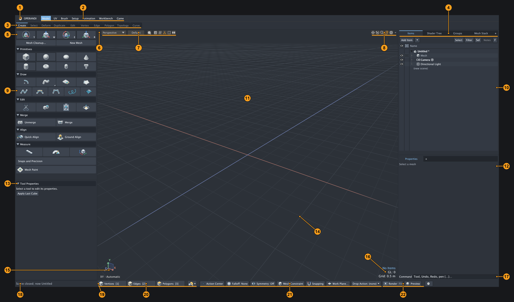

<!-- help-ids: Interface, 3D View, Toolbox, operandi.help.whatsThis, viewport.split, viewport.maximize, viewport.detach, operandi.viewport.close ; template: panel ; since: 0.1.0 -->
# Interface

The Operandi window has the same parts every time you open it: tools on
the left, your scene in the middle, lists and settings on the right, and a
bar of modes along the bottom.

This is the window on a Mac, with the default **Model** tool set, a new
scene, no tool active and nothing selected. **Show Work Plane** is turned
on and **Work Plane Opacity** raised to 60% so the work plane shows. The
numbers match the list below.

## Parts of the window

1. **Logo**: shows you are in Operandi. Click it to fold the top bar away.
2. **Tool set bar**: the set buttons (**Model**, **UV**, **Brush**,
   **Setup**, **Animation**, **Workbench**, **Game**). Click one to fill the
   **Tool Tabs** with that kind of work's tools. The rest of the window
   stays as it is.
3. **Tool Tabs**: click a tab (**Create**, **Select**, **Deform**, …) to
   fill the **Toolbox** with that family of tools. Drag a tab along the row
   to put the tabs in the order you like. From the keyboard,
   **Control+Tab** opens the next tab to the right and
   **Control+Shift+Tab** the one to the left; at the end of the row they
   wrap round to the other end. The tab opens as soon as you press the
   keys, and the tool you are using stays active.
4. **Panel-group tabs**: click a tab (**Items**, **Shader Tree**,
   **Groups**, **Mesh Stack**) to choose which list fills this panel; the
   **+** adds another one.
5. **Transform tools**: **Transform**, **Move**, **Rotate** and **Scale**,
   the tools you use most. Their keys are **Y**, **W**, **E** and **R**.
   Every tool set shares this one row; the **Setup** and **Animation** sets
   add **World** and **Local** (where the tools pivot) just below it.
6. **View dot**: drag it to move this view or tear it off into its own
   window. Right-click it for the view's frame menu.
7. **View header**: pick the view's camera (**Perspective**, **Top**,
   **Front**, …), its look, and what it shows.
8. **Navigation buttons**: drag these to pan, turn and zoom the view, fill
   the window with it, or open its settings (the gear).
9. **Toolbox**: click a tool to start using it. The buttons at the top
   (**Mesh Cleanup...**, **New Mesh**) are always there.
10. **Items list**: every item in your scene. Click one to select it; click
    the eye to hide or show it. A new scene starts with a **Mesh**, a
    **Camera** and a **Directional Light**.
11. **3D view**: where you see and shape your model. Drag in empty space
    to use the active tool.
12. **Properties**: settings for the selected item. With an item selected,
    tabs down the right side (**Mesh**, **Surface**, **Display**, …) switch
    pages.
13. **Tool Properties**: the active tool's settings. Type exact values
    here. With no tool active it says so.
14. **Grid**: the ground grid, a floor of lines at ground level, with
    colored lines for the main axes. **Grid** in the **Readout** gives
    the size of one square. Models hide the grid where they are in front
    of it, and the grid shows over any part of a model below or behind
    it, so you can see where a model crosses the ground. The work plane's
    grid works the same way.
15. **Work Plane**: the plane that new shapes are drawn and placed on.
    Unless you fix it, Operandi turns it to face the view; here it is the
    upright **XY** plane. It shows only while **Show Work Plane** is on
    (in the settings that **Work Plane…** in the **Mode bar** opens, or
    **Preferences > Display**), which is off in a new install.
16. **Axis marker**: shows which way X, Y and Z point. The line under it
    names the work plane (here **XY**, picked automatically).
17. **Readout**: what is selected, how much the screen is drawing (**GL**),
    and the size of one grid square.
18. **Command entry**: type a command and press **Return** to run it, the
    same way scripts do.
19. **Message line**: short messages from Operandi, such as what just
    happened.
20. **Mode bar**: the bar along the bottom that holds parts 21 to 23. Drag
    its grip to dock it at the top of the window instead.
21. **Selection modes**: choose what you click on in the 3D view: points
    (**Vertices**, key **1**), **Edges** (**2**) or **Polygons** (**3**).
    The button with the small arrow holds more modes.
22. **Modeling aids**: settings that change how every tool behaves: where
    it pivots (**Action Center**), how its effect fades (**Falloff**),
    mirroring (**Symmetry**), sticking to a surface (**Mesh Constraint**),
    **Snapping**, the **Work Plane**, and what happens when you drop a
    tool (**Drop Action**).
23. **Render and Preview**: make a finished picture of your scene
    (**F9**), or open a live preview of it (**F8**).

On Windows and Linux, the top row also has two parts that a Mac keeps
elsewhere:

- **Menu bar**: every command in Operandi lives somewhere in these menus.
  On a Mac they are in the macOS menu bar at the top of the screen.
- **Save, Undo and Redo**: save your scene, or step back and forward
  through your changes. **Undo** names the change it will take back. On a
  Mac, use **File > Save** and **Edit > Undo**, or their keys.

When a tool is active, two more parts appear: the **Tool handles** in the
3D view (drag an arrow, ring or square to change the selection) and the
**Tool hint** above the message line, which tells you how to finish or
leave the tool. [Bevel (polygons)](../modeling/polygon-bevel.md) shows
both.

A tool stays on while you use the rest of the window. Change a value in
**Properties**, click a button in the **Items** list or the **Mesh
Stack**, or press **N** for a new mesh: if the tool has already changed
something, that change is kept as its own undo step, the new command runs,
and the tool starts again on what is selected now. Clicks in the 3D view
still don't select while a tool is on: select first, then pick the tool.

## Common tasks

### Move a panel or bar

1. Rest the pointer in the panel's top-left corner until its **grip** fades
   in. (In a 3D view, use the **View dot** instead.)
2. Drag the grip to a new place, or out of the window to float it.

A floating window (a floated panel, a torn-off view, **Preview**, **Render**)
stays in front of Operandi's main window, so clicking the main window never
hides it. Switch to another app and that app can cover it.

### Dock a panel

1. Drag the panel's grip over the edge of another frame. A line shows
   where it will land.
2. Let go to dock it, or press **Esc** to cancel.

### Split the 3D view

1. Choose **View > Split View**.

**View > Tear Off View** puts the view under the pointer in its own window,
and **View > Close View** removes it. Press **Numpad 0** (or **Alt+0**) to
fill the window with the view under the pointer, and again to go back.

### Get help on anything

1. Press **F1**, or choose **Help > What's This?**. The pointer turns into
   a question mark.
2. Click a button, a menu entry, a panel or the 3D view. Its page in this
   guide opens in your web browser, and the click does nothing else.

Press **Esc** or right-click to stop without opening anything.
**Help > User Guide** opens the start of this guide. Rest the pointer on
a button to see its tooltip first: often that is all you need.

## Related

- [Getting started](../getting-started.md): moving around the 3D view.
- [Bevel (polygons)](../modeling/polygon-bevel.md): a tool page, with
  **Tool Properties** and handles in use.
