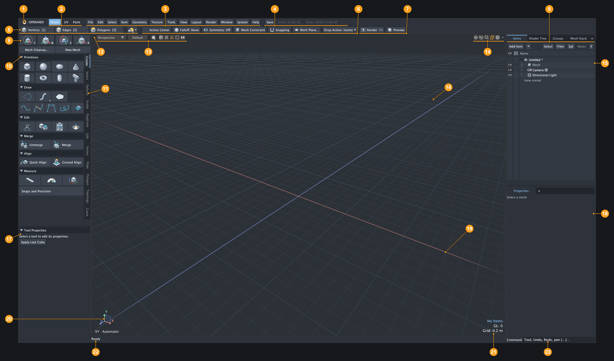

# The Operandi window



This is the window you see when Operandi opens with its default layout and
a new, empty scene. The
numbers match the list below.

1. **Logo** — Shows you are in Operandi.
2. **Layout bar** — Click a tab (Model, UV, Paint) to switch the whole window to a layout made for that kind of work.
3. **Menu bar** — Every command in the app lives somewhere in these menus.
4. **Save, Undo and Redo** — Save your scene, or step back and forward through your changes; Undo names the change it will take back.
5. **Selection modes** — Choose what you click on in the 3D view: points (vertices), edges or polygons; the button with the small arrow holds more modes.
6. **Modelling aids** — Settings that change how every tool behaves: where it pivots (Action Center), how far its effect fades (Falloff), mirroring (Symmetry), sticking to a surface (Mesh Constraint), snapping, the work plane and what happens when you drop a tool.
7. **Render and Preview** — Make a finished picture of your scene, or open a live preview of it.
8. **Panel-group tabs** — Click a tab to choose which list fills this panel; the **+** adds another one.
9. **Transform tools** — Move, Rotate, Scale and Transform, the tools you will use most; Y, W, E and R are their keys.
10. **Toolbox** — Click a tool here to start using it; the buttons above it (Mesh Cleanup, New Mesh) are always there.
11. **Tool Tabs** — Click a tab (Create, Select, Deform, …) to fill the toolbox with that family of tools.
12. **View dot** — Drag it to move or tear off this view; right-click it for the view's frame menu.
13. **View header** — Pick the view's camera (Perspective, Top, Front…), its look and what it shows.
14. **Navigation buttons** — Drag these to pan, turn and zoom the view, fill the window with it, or open its settings (the gear).
15. **Items list** — Every item in your scene; click one to select it, click the eye to hide or show it.
16. **3D view** — Where you see and shape your model. Drag on empty space to use the active tool.
17. **Tool Properties** — The active tool's settings; type exact values here. With no tool active it says so.
18. **Properties** — Settings for the selected item; the tabs down the right side (Mesh, Surface, Display, …) switch pages.
19. **Work plane grid** — The floor grid that new shapes sit on, with coloured lines for the main axes.
20. **Axis marker** — Shows which way X, Y and Z point; the line under it names the work plane (here XY, picked automatically).
21. **Readout** — What is selected, how much the screen is drawing (GL) and the size of one grid square.
22. **Message line** — Short messages from the app, such as "Ready" or what just happened.
23. **Command entry** — Type a command and press Return to run it, the same way scripts do.

When a tool is active, two more parts appear: the **Tool handles** in the
3D view (drag an arrow, ring or square to change the selection) and the
**Tool hint** above the message line, which tells you how to finish or
leave the tool.

## Moving things around

- In a 3D view, drag the **view dot** (12) to move the view or tear it off
  into its own window.
- Other panels and bars have a **grip** that fades in when you rest the
  pointer in their top-left corner. Drag the grip to move the panel, or
  drag it out to float it.
- To **dock** a panel, drag it over the edge of another frame; a line shows
  where it will land. Let go to dock it, or press Esc to cancel.

## Agreed names

Agreed by Jason, 2026-11-20. One line each on where the name comes from.

| # | Name | Source |
|---|---|---|
| 1 | Logo | The app mark; no name in the rules or code. |
| 2 | Layout bar | The rules' name (UIC-11); in this build its tabs share the menu bar's row. |
| 4 | Save, Undo and Redo | The three button labels; no group name elsewhere. |
| 5 | Selection modes | Left part of the code's **mode bar**; the state buttons of UIC-24. |
| 6 | Modelling aids | The set UIC-63 lists (action centre, symmetry, falloff, snapping, work plane). |
| 7 | Render and Preview | The two button labels. |
| 9 | Transform tools | The code's transform rows shared by every tool tab. |
| 11 | Tool Tabs | The code's name; the rules' "set buttons" (UIC-197). |
| 12 | View dot | The rules' name (UIC-71, UIC-193); replaces "corner dot". |
| 13 | View header | Replaces the rules' "viewport header" (UIC-25) and the code's "3D view header". |
| 14 | Navigation buttons | Named for what they do; the code's "header corner buttons". |
| 15 | Items list | The Items panel; "list" added for beginners. |
| 16 | 3D view | The panel kind "3D View"; replaces "viewport". |
| – | Tool handles | The code's "handles". |
| 19 | Work plane grid | From the code and preferences' "Grid and Work Plane". |
| 20 | Axis marker | Replaces the code's "axis gizmo". |
| – | Tool hint | Replaces the code's "active-tool exit hint". |
| 21 | Readout | The code's "readout lines". |
| 22 | Message line | The code's name. |
| 23 | Command entry | The rules' name (UIC-228, UIC-234); labelled "Command" on screen. |

Names taken straight from the rules: Menu bar (UIC-10), Panel-group tabs
(§10, UIC-155), Toolbox (UIC-197), Tool Properties (§9), Properties (§9).

---

Screenshot: the default window at 1920×1080, captured at 1.5× from version
`e3fb1b14`, on a fresh, empty scene with no tool active and nothing
selected. The picture is made by
`docs/manual/tools/make_ui_map.py` (needs Pillow):

```bash
python3 docs/manual/tools/make_ui_map.py <screenshot-2880.png>
```
